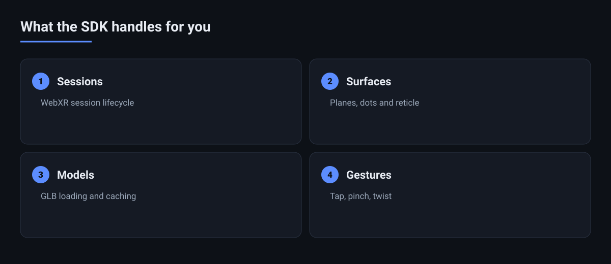
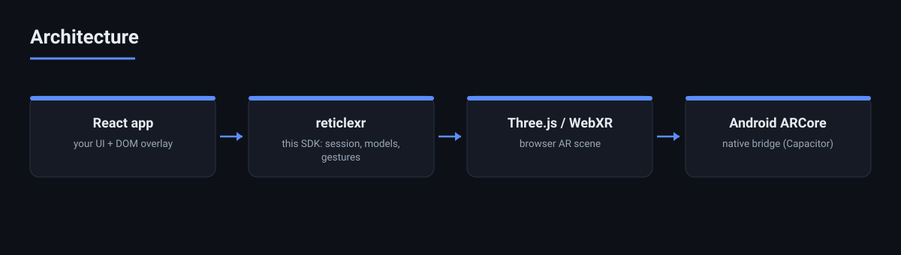

<p align="center">

</p>

# arcore-react

**A high-level AR SDK for React and Capacitor**

[](https://www.npmjs.com/package/capacitor-arcore) [](LICENSE)

Building product AR should not require every application to implement WebXR sessions, Three.js scenes, GLTF loading, hit testing, plane visualization and multi-touch gesture math. arcore-react (npm: `capacitor-arcore`) provides a higher-level AR API so your application can focus on products and UI while the library manages the underlying AR infrastructure.

## Install

```bash
npm install capacitor-arcore
```

## Quick start

```js
import { createARView } from 'capacitor-arcore';

const ar = createARView({
  overlay: document.querySelector('#ar-overlay'),
});

await ar.create({
  showReticle: true,
  showPlaneDots: true,
});

await ar.preloadModels([
  '/models/sofa.glb',
  '/models/chair.glb',
]);

await ar.placeModel('/models/sofa.glb');
```

Users then interact naturally with the scene: **tap to place, pinch to scale, and twist with two fingers to rotate**.

## API at a glance

| Call | What it does |
|---|---|
| `createARView(options)` | Entry point. Creates an AR view bound to a React DOM overlay element. |
| `ar.create({ showReticle, showPlaneDots })` | Starts the AR session with surface feedback enabled. |
| `ar.preloadModels(urls)` | Preloads and caches GLB/GLTF models so switching products is fast. |
| `ar.placeModel(url)` | Places a model at the reticle; model switching keeps placement, scale and rotation. |
| Gestures | Tap to place, pinch to scale, two-finger twist to rotate — handled by the library. |
| Runtime styling | Change model colors and textures at runtime; capture AR screenshots. |



## Features

- Surface detection with dotted plane feedback and a placement reticle
- Tap-to-place GLB/GLTF models with model preloading and caching
- Pinch-to-scale and two-finger rotation gestures built in
- Runtime colors and textures, AR screenshot capture
- React DOM overlays rendered over the immersive AR view
- WebXR + Three.js in the browser, with a native Android ARCore bridge

## Compatibility

| Area | Support |
|---|---|
| Browser AR | WebXR-capable browsers (Three.js scene) |
| Native | Android via the Capacitor ARCore plugin in `android/` |
| Framework | React + Capacitor applications |
| Models | GLB / GLTF |

## How it fits together



## Documentation

- [docs/API.md](docs/API.md) — Full API reference
- [docs/INSTALLATION.md](docs/INSTALLATION.md) — Installation and setup
- [docs/HTTPS_SETUP.md](docs/HTTPS_SETUP.md) — HTTPS setup for device testing
- [docs/PHONE_TESTING.md](docs/PHONE_TESTING.md) — Testing on a physical phone

## Contributing

Issues and pull requests are welcome. The JavaScript API lives in `src/`, the native Android plugin in `android/`, and a runnable example app in `example/` — please test changes against the example app on a WebXR browser or an ARCore device before submitting.

## License

MIT — see [LICENSE](LICENSE). You are free to use, modify and distribute this project under the MIT terms.


---

Built by **Saugat Shahi** — [github.com/ShahiCrafts](https://github.com/ShahiCrafts)
