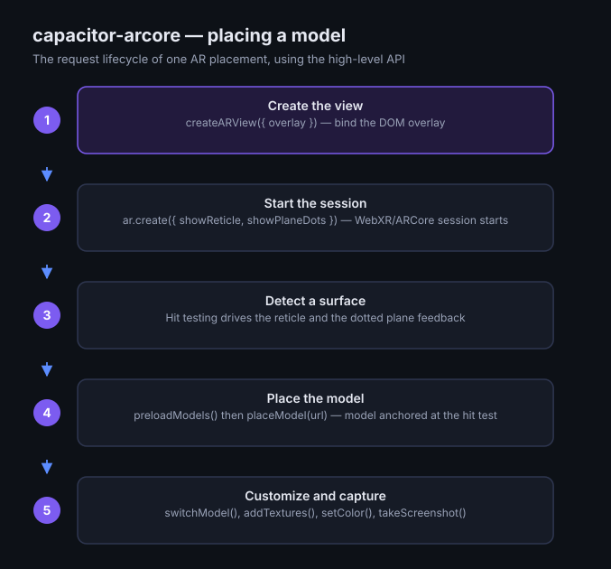

<div align="center">

<h1>arcore-react</h1>

**A high-level AR SDK for React and Capacitor.**

Build WebXR and ARCore experiences with surface detection, 3D model placement, gestures, customization, and DOM overlays — published on npm as `capacitor-arcore`.

[](https://www.npmjs.com/package/capacitor-arcore) [](LICENSE)   

[Quick start](#quick-start) · [How it works](#how-it-works) · [Features](#features) · [Usage](#usage) · [FAQ](#faq)

<code>npm install capacitor-arcore</code>

</div>


## Overview

`arcore-react` is the repository for the **capacitor-arcore** package: a developer-friendly AR abstraction for React, Capacitor, WebXR, ARCore and Three.js. It exists so application code does not have to wire XR sessions, hit testing, model transforms, gesture handling and rendering infrastructure by hand.

The package has two layers. The high-level API in `src/` (`createARView()`, gestures, hooks, customization) targets WebXR in the browser, while `src/index.js` registers a native Capacitor plugin whose Android implementation lives in `android/` (session, surface, anchor, model and render managers in Java). An `example/` Capacitor app shows the intended integration, including HTTPS and on-device testing.

## Features

- **`createARView()` high-level API** — one object to create a session, preload models and place them, instead of coordinating WebXR, Three.js and hit tests yourself
- **Surface feedback** — a center placement reticle while a hit-test surface exists, plus optional dotted plane visualization (`showPlaneDots`)
- **Model placement and switching** — place a GLB/glTF model on a hit-test anchor; switch models in place while preserving placement, scale and rotation
- **Customization** — add textures, apply a texture or a solid color to the placed model
- **Gestures** — tap to place, pinch to scale, two-finger twist to rotate; DOM elements marked `data-ui="true"` are ignored by the gesture layer
- **AR screenshots** — capture the current AR view from code
- **DOM overlays** — render React UI over the AR view
- **Native ARCore bridge** — session lifecycle, hit testing, anchors and model management on Android through the Capacitor plugin in `android/`

## How it works

Application code talks only to the high-level JavaScript API. On the web, `src/web.js` and `src/ar-view.js` run a WebXR session with a Three.js scene; on Android, the same package registers the native ARCore plugin and the Java managers own the session, surfaces and anchors.


[Open the full-size figure](docs/assets/architecture.svg)

A typical placement flow, from session start to a customized model:



[Open the full-size figure](docs/assets/workflow.svg)

## Tech stack

| Area | Technology | Notes |
| --- | --- | --- |
| Language | JavaScript | Package source in `src/`, native side in Java (`android/`) |
| Runtime | Capacitor | `@capacitor/core` peer integration; plugin registered as `ARCore` |
| Rendering | Three.js | Scene, models (GLB/glTF), reticle and plane dots |
| Web AR | WebXR | Browser implementation in `src/web.js` |
| Native AR | Android ARCore | Session, surface, anchor, model and render managers |
| App framework | React 16.8+ | Hooks in `src/hooks.js`; functional API also exported |

## Project structure

```text
arcore-react/
├── src/                  High-level JS API
│   ├── index.js          Native plugin registration and ARCore API
│   ├── ar-view.js        createARView() — session, models, customization
│   ├── web.js            WebXR implementation
│   ├── gestures.js       Tap, pinch and twist gesture handling
│   └── hooks.js          React hooks
├── android/              Native Android ARCore plugin (Java)
│   └── src/main/java/com/capacitor/arcore/
├── example/              Example Capacitor app (Vite + React)
├── docs/                 API, installation, HTTPS and phone-testing guides
├── package.json          Published as capacitor-arcore
└── LICENSE               MIT
```

## Quick start

### Prerequisites

- Node.js and npm
- A Capacitor app (the `example/` app is a working reference)
- For WebXR testing: an HTTPS origin — see `docs/HTTPS_SETUP.md`
- For native testing: an ARCore-capable Android device — see `docs/PHONE_TESTING.md`

### Install and run

Install the package in your Capacitor app:

```bash
npm install capacitor-arcore
npx cap sync
```

Or run the bundled example app (it installs the package from the repo root first):

```bash
cd example
npm install
npm run dev
```

For HTTPS device testing in the example app:

```bash
npm run dev:https
```

### Commands

| Command | Description |
| --- | --- |
| `npm run dev` | Example app: start the Vite dev server |
| `npm run dev:https` | Example app: generate a local cert and serve over HTTPS for device testing |
| `npm run build` | Example app: production build |
| `npm run sync` | Example app: `cap sync` — copy web assets and update native projects |
| `npm run open:android` | Example app: open the Android project in Android Studio |

## Usage

The high-level API, from `docs/API.md`:

```js
import { createARView } from 'capacitor-arcore';

const ar = createARView({ overlay: document.querySelector('#ar-overlay') });
await ar.create({ showReticle: true, showPlaneDots: true });
await ar.preloadModels(['/models/sofa.glb', '/models/chair.glb']);

ar.enableCustomization({ modelUrl: () => '/models/sofa.glb' });
await ar.placeModel('/models/sofa.glb');       // center hit-test + anchor
await ar.switchModel('/models/chair.glb');     // preserves placement/scale/rotation
ar.addTextures({ oak: '/textures/oak.jpg' });
await ar.applyTexture('oak');
await ar.setColor('#68705b');
const shot = await ar.takeScreenshot();
```

A functional API is also exported for codebases that prefer functions: `takeScreenshot(view)`, `enableCustomization(view)`, `addTextures(view)`, `switchModel(view)` and `placeModel(view)`. The native plugin API (`ARCore.startSession`, `hitTest`, `placeModel`, `setTransform`, `setMaterial`, events via `on`/`addListener`) is documented in `docs/API.md` and `src/index.js`.

## Documentation

- [API reference](docs/API.md) — the high-level `createARView()` API and the functional exports
- [Installation](docs/INSTALLATION.md)
- [HTTPS setup](docs/HTTPS_SETUP.md) — WebXR requires a secure context
- [Phone testing](docs/PHONE_TESTING.md) — testing on a real device
- [Contributing](CONTRIBUTING.md) and [Changelog](CHANGELOG.md)

## FAQ

<details>
<summary><strong>Why does AR need HTTPS?</strong></summary>

WebXR only runs in a secure context. The example app ships a certificate script (`npm run dev:https`) and `docs/HTTPS_SETUP.md` explains the setup.

</details>

<details>
<summary><strong>Do I have to use the native plugin?</strong></summary>

No. The high-level API runs on WebXR in the browser through `src/web.js`. The native ARCore plugin under `android/` is used when the Capacitor app runs on Android.

</details>

<details>
<summary><strong>Which model formats are used?</strong></summary>

The API and examples use GLB/glTF models (for example `/models/sofa.glb`).

</details>

## Contributing

Issues and pull requests are welcome. Keep changes focused, follow the existing code style, and describe how you verified your change.

## License

MIT — see [LICENSE](LICENSE). Copyright (c) 2026 ShahiCrafts.

---

<div align="center">

Built by [Saugat Shahi](https://github.com/ShahiCrafts) · [github.com/ShahiCrafts/arcore-react](https://github.com/ShahiCrafts/arcore-react)

</div>
