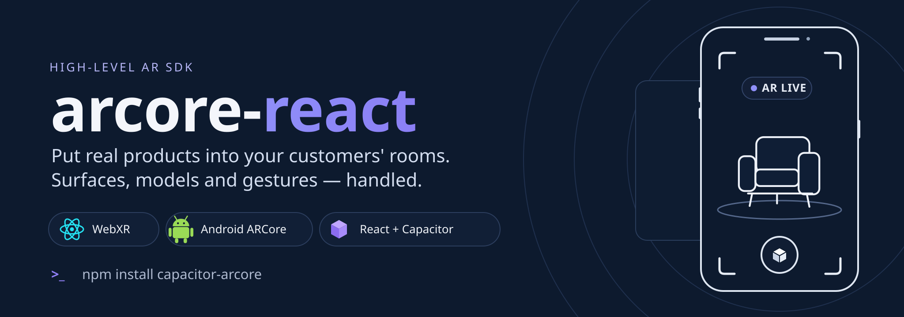
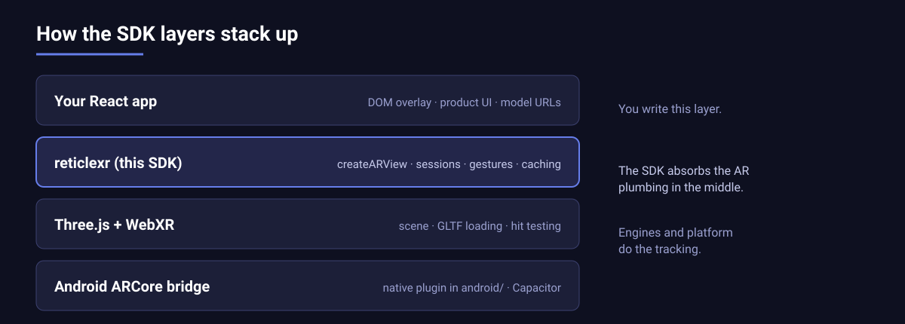

<p align="center">
  
</p>

<p align="center">
  <a href="https://www.npmjs.com/package/capacitor-arcore"></a>
  <a href="LICENSE"></a>
</p>

Building product AR should not require every application to implement WebXR sessions, Three.js scenes, GLTF loading, hit testing, plane visualization, and multi-touch gesture math. **arcore-react** (npm: `capacitor-arcore`) is a high-level AR SDK for React + Capacitor that absorbs all of that, so your app can focus on products and UI.

## Install

```bash
npm install capacitor-arcore
```

## Quick start

```js
import { createARView } from 'capacitor-arcore';

const ar = createARView({
  overlay: document.querySelector('#ar-overlay'),
});

await ar.create({
  showReticle: true,
  showPlaneDots: true,
});

await ar.preloadModels([
  '/models/sofa.glb',
  '/models/chair.glb',
]);

await ar.placeModel('/models/sofa.glb');
```

From there, your users interact naturally with the scene: **tap to place, pinch to scale, twist with two fingers to rotate.** Switch models and the placement, scale and rotation carry over.

## API at a glance

| Call | What it does |
|---|---|
| `createARView(options)` | Entry point. Creates an AR view bound to a React DOM overlay element. |
| `ar.create({ showReticle, showPlaneDots })` | Starts the AR session with surface feedback enabled. |
| `ar.preloadModels(urls)` | Preloads and caches GLB/GLTF models so switching products is fast. |
| `ar.placeModel(url)` | Places a model at the reticle; switching keeps placement, scale and rotation. |
| Gestures | Tap to place, pinch to scale, two-finger twist to rotate — handled by the library. |
| Runtime styling | Change model colors and textures at runtime; capture AR screenshots. |

Full reference: [docs/API.md](docs/API.md).

## How it works



In the browser, the SDK drives a Three.js scene over WebXR. On Android, the same JavaScript API talks through Capacitor to a native ARCore plugin (in `android/`), so one codebase covers both.

## What you get

- **Surface detection** with dotted plane feedback and a placement reticle
- **Tap-to-place** GLB/GLTF models, with preloading and caching for fast product switching
- **Gestures built in** — pinch-to-scale and two-finger rotation
- **Runtime colors and textures**, and AR screenshot capture
- **React DOM overlays** rendered over the immersive AR view
- **Two runtimes, one API** — WebXR in the browser, native ARCore on Android

## Compatibility

| Area | Support |
|---|---|
| Browser AR | WebXR-capable browsers (Three.js scene) |
| Native | Android via the Capacitor ARCore plugin in `android/` |
| Framework | React + Capacitor applications |
| Models | GLB / GLTF |

## Documentation

- [docs/API.md](docs/API.md) — full API reference
- [docs/INSTALLATION.md](docs/INSTALLATION.md) — installation and setup
- [docs/HTTPS_SETUP.md](docs/HTTPS_SETUP.md) — HTTPS setup for device testing
- [docs/PHONE_TESTING.md](docs/PHONE_TESTING.md) — testing on a physical phone

A runnable example app lives in [`example/`](example/).

## Contributing

Issues and pull requests are welcome. The JavaScript API lives in `src/`, the native Android plugin in `android/`. Please test changes against the example app — on a WebXR browser or an ARCore device — before submitting.

## License

MIT — see [LICENSE](LICENSE).

---

Built by **Saugat Shahi** — [github.com/ShahiCrafts](https://github.com/ShahiCrafts)
